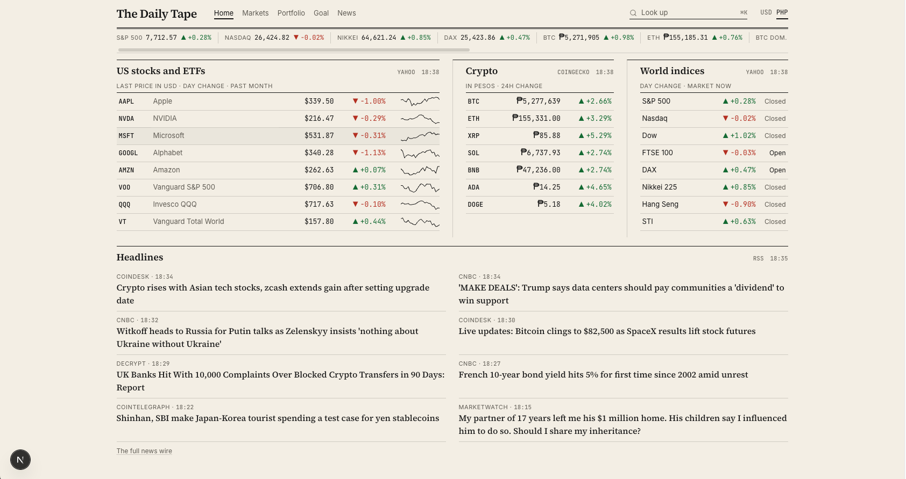

# The Daily Tape

A local, self-hosted financial terminal inspired by the Bloomberg Terminal, built on free data. Focus: crypto and international markets, with PHP as the home currency.

**Status:** Phase 4a done. On top of v1's live market screens (front page, world indices, crypto board, price charts, descriptions, news, function directory), the paper now holds your own portfolio: transactions you enter by hand, holdings with value and P&L in pesos, cash-flow yield, and months to your income goal. CSV import from exchanges is Phase 4b. See [docs/ROADMAP.md](docs/ROADMAP.md) for the full plan.



## Quick start

After the one-time [setup](#setup):

```bash
./start.sh
```

This starts the backend on `http://localhost:8000` and the frontend on `http://localhost:3000`. Open http://localhost:3000. Press Ctrl+C in the same terminal to stop both.

## What runs today

The paper is cream, ink, and serif headlines. Every screen opens from **Look up** (`Cmd+K`, `Ctrl+K`, or `/`): type a command and press Enter.

| Type | Screen | What it shows |
| --- | --- | --- |
| Home | Front page | US stocks and ETFs with 1-month sparklines, your coins, eight world indices with open/closed, and the latest headlines |
| `WEI` | World equity indices | 16 indices by region plus BTC, ETH, USD/PHP, the dollar, gold, oil, and the US 10Y, with day and YTD change |
| `CRYPTO` | Crypto board | Top 100 coins: price, 1h/24h/7d change, volume, market cap, 7-day sparkline |
| `NVDA GP`, `BTC GP` | Price chart | Candles, volume, SMA 20/50/200, ranges 1D to MAX, hover legend with OHLC and SMA values |
| `NVDA DES`, `VOO DES`, `ETH DES` | Description | Stocks: key stats, valuation, profile. ETFs: fund facts. Coins: supply, all-time high and distance from it, links |
| `N` | News wire | Markets and crypto headlines with All / Markets / Crypto tabs |
| `HELP` | Function directory | Every function, how to type it, and the keyboard shortcuts |
| `PORT` | Portfolio | Value, cost, unrealized and realized P&L, today's move, holdings at average cost, allocation by class, region, and currency, cash per account |
| `TXN` | Transactions | Add, edit, and delete buys, sells, dividends, rewards, transfers, and deposits |
| `YLD` | Cash-flow yield | Yearly and monthly income per holding in pesos, after dividend withholding |
| `GOAL` | Income goal | Income now vs your monthly target, capital needed, months to goal, and the projected path |

A ticker alone (`NVDA`) opens its description. Up arrow in an empty Look up box recalls recent commands. International listings use Yahoo suffixes (`7203.T GP`, `0700.HK DES`), indices use `^` (`^N225 GP`).

**USD / PHP toggle** (top right): switches the ticker tape's USD prices, the crypto board, coin descriptions, Home's crypto column, and price charts to pesos. Peso changes include the peso's own move. Charts convert every candle at the USD/PHP rate of its own day (or 5 minutes), never today's rate, so a peso chart shows what the asset was really worth in pesos at the time. Indices, exchange rates, and non-USD listings (like `7203.T`) stay in their own currency, labeled.

## Your portfolio

The Portfolio page holds `PORT` and `TXN`; the Goal page holds `GOAL` and `YLD`. Everything is stored in a local SQLite file, `backend/data/tape.db` (git-ignored, never leaves your Mac).

**Entering transactions (TXN).** What matters is what you bought, how much, and when. The price you paid is optional: with it, PORT also shows cost and P&L for that holding; without it, they show —. Type in the entry row above the table and press Enter. Pick the account first: the price currency follows it (Coins.ph: PHP, Binance: USDT, Gotrade: USD).

| Type | Units / amount | Also enter |
| --- | --- | --- |
| `DEPOSIT` | dollars or USDT received (asset `USD`, `USDT`, or `PHP`) | the pesos you sent, optional (a record only) |
| `BUY`, `SELL` | units of the asset (`BTC`, `VOO`) | price per unit (optional), fee, and the fee's currency if different (`BNB`, or the coin itself) |
| `REWARD` | units received (staking, interest paid in coins) | price on the day, optional |
| `DIVIDEND` | cash received, after tax | its currency |
| `TRANSFER` | units moved between accounts | the network fee, in the coin |
| `WITHDRAW` | amount taken out | pesos received, optional |

Tab to a row, then ↑ ↓ to move, E to edit in place, Delete to remove (it asks first).

**How cost works.** Average cost: units × price plus the trading fee.

- A holding with any buy that has no price shows its units and value, but its cost and P&L show — and stay out of the cost and P&L totals. A sell without a price books no P&L.
- Dollar buys (Gotrade, Binance) convert to pesos at Yahoo's USD/PHP close on the trade date. Exchange spreads and FX fees aren't tracked.
- Coins.ph buys are priced in pesos, so the pesos you paid are the cost.
- A sell takes units out at average cost; the difference is realized P&L. A reward adds units at zero cost. A transfer's network fee removes units but keeps the cost. A fee paid in another coin (BNB) adds its value to the cost and comes out of your BNB.
- Value in pesos uses today's USD/PHP. Past amounts are never converted at today's rate, so P&L in pesos includes the peso's own move.
- Deposits and withdrawals are a record only; they don't change cost or holdings.
- **Cash** is a balance you type per account on PORT. Buys and sells don't change it.

**Yield and goal.** YLD counts, per holding, Yahoo's dividends from the last 12 months (less the withholding rate you set, 25% by default), or your `REWARD` rows from the last 12 months, or a staking or interest rate you type. GOAL shows that as **income now**, and next to it a hypothetical **if converted** figure (everything you hold at your assumed yield). Months to goal grows your income-producing capital (or everything, with the toggle) at the assumed yield plus your monthly contribution until it can pay the target. Target, contribution, and yield start at ₱2,000, ₱2,000, and 5%, and you change them on the page.

The portfolio holds USD-priced listings (US stocks and ETFs, and crypto) for now; a ticker priced in another currency is refused with a message.

**Chart legend**: hover a candle for its prices and time. Intraday candles show their local time; daily, weekly, and monthly candles show when they closed in your time (e.g. "closed 04:00 Manila"), or the last trade if still open.

**Backend**: a FastAPI backend that fetches market data, cleans it, caches it, and serves JSON (or CSV for Excel).

| Endpoint | What it returns | Source | Cache |
| --- | --- | --- | --- |
| `GET /api/health` | Server status | local | none |
| `GET /api/quote/{ticker}` | Price, change, day range, 52-week range, market cap | Yahoo | 60 s |
| `GET /api/quotes?symbols=AAPL,NVDA,...` | Last close, day change, and a month of closes for up to 25 tickers in one batch | Yahoo | 60 s |
| `GET /api/chart/{ticker}?range=1y&interval=1d&currency=native\|PHP` | OHLCV candles with SMA 20/50/200 and each bar's close time; `currency=PHP` converts bar by bar at that bar's USD/PHP rate | Yahoo | 60 s intraday, 10 min daily |
| `GET /api/des/{ticker}` | Stocks/ETFs: profile, valuation, 52-week range, dividend yield, fund facts. Coins: profile, supply, all-time high, distance from it (USD and PHP) | Yahoo / CoinGecko | 6 h profile (coin prices 2 min) |
| `GET /api/wei` | 16 world indices + BTC, ETH, USD/PHP, DXY, gold, crude, US 10Y, with YTD and open/closed | Yahoo | 60 s |
| `GET /api/news?category=all\|markets\|crypto&limit=50` | Deduplicated headlines, newest first | RSS | 5 min per feed |
| `GET /api/crypto/markets` | Top 100 coins in USD and PHP, 1h/24h/7d change, sparklines | CoinGecko | 2 min |
| `GET /api/crypto/global` | Total crypto market cap and volume (USD, PHP), BTC and ETH dominance | CoinGecko | 5 min |
| `GET /api/transactions` · `POST` · `PUT /{id}` · `DELETE /{id}` | Your transactions, newest first | local | none |
| `GET /api/accounts` · `PUT /api/accounts/{id}/cash` | Accounts and the cash you typed in | local | none |
| `GET /api/portfolio?currency=PHP\|USD` | Totals, holdings, allocation, cash | Yahoo + local | 60 s prices |
| `GET /api/yield` · `PUT`/`DELETE /api/yield/{asset}` | Income per holding in pesos; set or clear a staking or interest rate | Yahoo + local | 60 s prices |
| `GET /api/goal` | Income now, capital needed, months to goal, month-by-month projection | Yahoo + local | 60 s prices |
| `GET /api/settings` · `PUT` | Goal target, contribution, assumed yield, withholding, include-everything toggle | local | none |

Tickers accept aliases: `BTC`, `ETH`, `XRP`, `SOL`, `BNB`, `ADA`, `DOGE`, `USDPHP`.

Every response looks like `{"data": ..., "meta": {"source", "as_of", "cached", "stale"}}`. Errors look like `{"error": {"code", "message"}}` with a real HTTP status (400, 404, 502). If a source fails, the last good copy is served with `stale: true`, and the screen says "Stale" in its header.

**Excel:** add `?format=csv` to `/api/wei`, `/api/quotes`, `/api/chart/...`, `/api/news`, `/api/crypto/markets`, `/api/transactions`, `/api/accounts`, `/api/portfolio`, `/api/yield`, or `/api/goal`, then in Excel use Data → From Web and paste the URL. Each portfolio table also has a **CSV** link in its header.

**SQL:** the schema is in `backend/sql/migrations/` and every query the app runs is a `.sql` file in `backend/sql/queries/`. Open `backend/data/tape.db` in any SQLite tool (`sqlite3 backend/data/tape.db`) and run them yourself; `running_units.sql` uses a window function.

## Setup

Requires Python 3.11+ (built with 3.12) and Node 20.9+ (built with Node 24).

```bash
cd backend
python3.12 -m venv .venv
.venv/bin/pip install -r requirements.txt
```

```bash
cd frontend
npm install
```

The frontend calls the backend at `http://localhost:8000`. To change that, copy `frontend/.env.example` to `frontend/.env.local` and edit `NEXT_PUBLIC_API_URL`.

## Run

```bash
./start.sh
```

Or run each half yourself, in two terminals:

```bash
cd backend
.venv/bin/uvicorn app.main:app --port 8000
```

```bash
cd frontend
npm run dev
```

Open http://localhost:3000 for the paper and http://localhost:8000/docs to try every endpoint in the browser.

## Test

Offline unit tests (the network is blocked during tests):

```bash
cd backend
.venv/bin/pytest
```

Frontend unit tests (formatting, command parsing, tape and chart math, PHP views), types, lint, and a production build:

```bash
cd frontend
npm test
npx tsc --noEmit
npm run lint
npm run build
```

Backend tests use a fresh temporary database each, so they never touch your portfolio. To try things without touching it either, point the app at a scratch file: `TAPE_DB=/tmp/test.db ./start.sh`.

Smoke test against the running backend with real data (every endpoint, plus AAPL, NVDA, VOO, 7203.T, BTC, ETH, PHP=X; portfolio endpoints are only read, never written):

```bash
./scripts/smoke_test.sh
```

## Layout

```
backend/app/main.py        FastAPI app, CORS, error envelope
backend/app/core/          cache, clean (NaN -> null), tickers + aliases, WEI rows + market hours
backend/app/db/            SQLite connection, .sql query loader, migrations runner
backend/app/services/      yahoo.py, coingecko.py, rss.py (fetchers + pure shapers)
backend/app/services/costbasis.py  the cost engine: average cost, fees, rewards, transfers
backend/app/services/portfolio.py  PORT and YLD numbers; goal.py: GOAL math
backend/sql/migrations/    schema, one numbered file per change
backend/sql/queries/       every query the app runs, one per file
backend/app/routers/des.py DES: Yahoo for stocks and ETFs, CoinGecko for coins
backend/app/routers/       one router per area
backend/tests/             offline pytest suite
scripts/smoke_test.sh      live endpoint check
start.sh                   starts backend + frontend, Ctrl+C stops both
frontend/src/app/          pages: sections (/, /markets ...) and functions (/fn/GP/NVDA)
frontend/src/functions/    one folder per terminal function: index.tsx (registry entry) + the screen
frontend/src/components/   Masthead, TickerTape, CommandPalette, Panel, Num, Chart, FrontPage
frontend/src/lib/          api client, formatters, registry, command parser, chart/crypto/WEI helpers
frontend/src/lib/frontPage.ts  the lists Home shows (edit to change your front page)
docs/ROADMAP.md            function catalog and phases
docs/data-sources.md       each source's coverage, limits, quirks
```

## Data sources

Yahoo Finance (`yfinance`), CoinGecko public API, and public RSS feeds. Charts are drawn with TradingView [Lightweight Charts](https://www.tradingview.com/lightweight-charts/). Details and limits in [docs/data-sources.md](docs/data-sources.md). This is an information tool only: no trading or broker connections.
